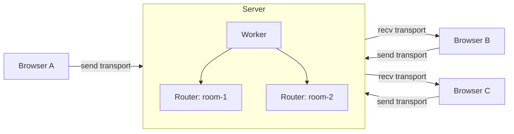

# mediasoup Multi-Room Video Calling

A multi-room video calling app built on [mediasoup](https://mediasoup.org/) (SFU architecture). Users land in a lobby, see the active rooms, and can join one or create a new one. Each room is fully isolated, with its own mediasoup Router and its own set of peers.

Built with **React + TypeScript + Vite** on the frontend and **Node.js + Express + Socket.IO + mediasoup** on the backend.

<!-- Add a screenshot or GIF here -->
<!--  -->

## Features

- **Multiple isolated rooms**: one mediasoup Router per room, so media never leaks between rooms
- **Lobby with live room list**: polls the server every few seconds; empty rooms disappear automatically
- **Audio + video** via Opus and VP8
- **Late joiners supported**: new peers automatically consume everyone already streaming
- **Clean leave handling**: leaving a room (Back button, closing the tab) removes the peer and their video tile for everyone else
- **Dynamic video grid** that adapts to the number of participants

## How It Works



Every browser opens one **send transport** (its own camera and mic) and one **recv transport** (everyone else's streams). The server routes media between peers on the same Router. It never mixes or re-encodes it.

### Server structure

```
Worker (C++ subprocess)
  └── RoomManager
        ├── rooms: Map<roomId, Room>
        └── socketToRoom: Map<socketId, roomId>

Room
  ├── router: Router
  └── peers: Map<socketId, Peer>
        └── Peer { sendTransport, recvTransport, videoProducer, audioProducer, consumers }
```

### Signaling flow

| Direction | Event | Purpose |
| --- | --- | --- |
| Client → Server | `joinRoom` | Join (or create) a room; returns the Router's RTP capabilities |
| Client → Server | `createTransport` | Create a `send` or `recv` WebRTC transport |
| Client → Server | `connectTransport` | Complete the DTLS handshake |
| Client → Server | `produce` | Start sending video or audio |
| Client → Server | `consume` | Receive another peer's video and audio |
| Client → Server | `getProducers` | List peers already streaming (for late joiners) |
| Client → Server | `leaveRoom` | Leave the room without dropping the socket |
| Server → Client | `newProducer` | A peer in the room started streaming |
| Server → Client | `producerClosed` | A peer in the room left |

HTTP: `GET /rooms` returns `{ rooms: string[] }` for the lobby.

## Project Structure

```
.
├── server/
│   ├── index.ts            # HTTPS + Socket.IO + mediasoup Worker bootstrap
│   ├── roomManager.ts      # RoomManager and Room classes
│   ├── socketHandler.ts    # Socket.IO event handlers
│   └── certs/              # key.pem and cert.pem (not committed)
└── client/
    └── src/
        ├── App.tsx             # Routes: / → Lobby, /room/:roomId → Room
        ├── socket.ts           # Singleton Socket.IO client
        ├── deviceManager.ts    # mediasoup-client Device loader
        ├── hooks/
        │   └── useMediasoup.ts # All transport / producer / consumer logic
        └── pages/
            ├── Lobby.tsx       # Room list + create room
            └── Room.tsx        # Video grid UI
```

> Adjust the folder names above to match your repo layout.

## Getting Started

### Prerequisites

- **Node.js** 18+
- Build tools required by mediasoup's C++ worker: **Python 3** and a C++ toolchain (see the [mediasoup installation docs](https://mediasoup.org/documentation/v3/mediasoup/installation/))
- **OpenSSL** (or any other way to generate a local certificate)

### 1. Clone and install

```bash
git clone https://github.com/dibakarghosh03/mediasoup-multi-room.git
cd mediasoup-multi-room

cd server && npm install
cd ../client && npm install
```

### 2. Generate a local HTTPS certificate

Browsers only allow camera and microphone access on secure origins, so the server runs over HTTPS.

```bash
cd server
mkdir certs
openssl req -x509 -newkey rsa:2048 -nodes \
  -keyout certs/key.pem -out certs/cert.pem \
  -days 365 -subj "/CN=localhost"
```

### 3. Configure environment variables

Create `server/.env`:

```env
# IP address clients use to reach the server's media ports.
# Use 127.0.0.1 for local testing, or your LAN / public IP otherwise.
ANNOUNED_ADDRESS=127.0.0.1
```

### 4. Run it

```bash
# Terminal 1: server (listens on https://localhost:3001)
cd server
npm run dev

# Terminal 2: client
cd client
npm run dev
```

### 5. Trust the self-signed certificate

Because the certificate is self-signed, open `https://localhost:3001` once in your browser and accept the warning. Without this, the client's Socket.IO connection and `/rooms` requests will be blocked.

Then open the Vite URL in two browser tabs (or two devices), join the same room, and you should see each other.

## Configuration Notes

| Setting | Where | Default |
| --- | --- | --- |
| Server port | `server/index.ts` | `3001` |
| Server URL used by the client | `client/src/socket.ts`, `client/src/pages/Lobby.tsx` | `https://localhost:3001` |
| RTP/UDP port range | `server/roomManager.ts` | `10000–10100` |
| Supported codecs | `server/roomManager.ts` | Opus (audio), VP8 (video) |

If you deploy or test across devices, make sure the UDP and TCP ports in the RTP range are open in your firewall and that `ANNOUNED_ADDRESS` is reachable from the clients.

## Current Limitations

- No authentication or room passwords
- A single mediasoup Worker (one CPU core handles all rooms)
- No TURN server, so peers behind restrictive NATs may fail to connect
- Lobby uses polling rather than push updates
- Rooms are held in memory, so they are lost on server restart

## Roadmap

- [ ] Mute / camera toggle controls
- [ ] Live participant counts in the lobby
- [ ] Multiple Workers with room-to-worker balancing
- [ ] Screen sharing
- [ ] Display names instead of socket IDs

## Tech Stack

**Backend:** Node.js, TypeScript, Express, Socket.IO, mediasoup
**Frontend:** React, TypeScript, Vite, Tailwind CSS, React Router, mediasoup-client, socket.io-client
